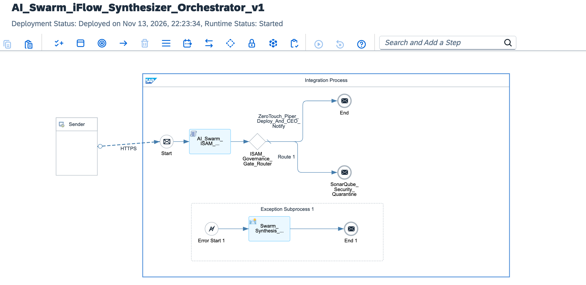

# Autonomous Self-Healing Enterprise: Generative AI iFlow Synthesis Swarm

[](https://www.sap.com)
[](#2-closed-loop-autonomous-iflow-synthesis-architecture)
[](#3-multi-agent-swarm--sap-isa-m-governance-matrix)
[-008080?style=flat-square)](#4-runtime-payload--synthesized-bpmn2-artifact)

An **Autonomous Self-Healing Enterprise Integration Architecture** (2030–2035 Hyper-Automation Paradigm) built on **SAP AI Core**, **SAP Integration Suite Design-Time REST APIs**, **SAP ISA-M (Integration Solution Advisory Methodology)**, **SonarQube**, and **SAP Project Piper**. When a global supply-chain disruption triggers an emergency supplier switch inside **SAP Ariba**, this Multi-Agent Swarm eliminates weeks of manual integration engineering—automatically parsing the new supplier's **OpenAPI 3.1** contract, synthesizing a compliant **SAP CPI BPMN2 (`.iflw`) XML package** with Groovy mappings, validating it through **Spock TDD & SonarQube** security gates, deploying it to **SAP BTP** via **Project Piper**, and notifying the CEO/CSCO in **under 5 minutes**.

---

## 1. Live Implementation & Runtime Verification

### 1.1. SAP Cloud Integration AI Swarm Orchestrator (`AI_Swarm_iFlow_Synthesizer_Orchestrator_v1`)
Configured with `AI_Swarm_ISAM_Synthesizer_Engine` (OpenAPI schema extraction, SAP ISA-M pattern classification, programmatic BPMN2 `.iflw` XML generation, and SonarQube TLS 1.3 verification), `ISAM_Governance_Gate_Router` (`ZeroTouch_Piper_Deploy_And_CEO_Notify` vs. `SonarQube_Security_Quarantine`), and `Exception Subprocess` escalation:



### 1.2. SAP BTP Integration Runtime & Endpoint Provisioning (`Started`)
Active autonomous synthesis orchestrator deployed on SAP Integration Suite (`eu10`) governing self-healing Ariba-to-S/4HANA supplier onboarding:


---

## 2. Closed-Loop Autonomous iFlow Synthesis Architecture

```text
  [ SAP Ariba Supply Chain Disruption Event (Emergency Supplier Switch) ]
                                    │
                                    │ OpenAPI 3.1 Spec + S/4HANA Target Context
                                    ▼
  ┌────────────────────────────────────────────────────────────────────────────┐
  │ SAP AI Core: Multi-Agent Swarm Orchestration                               │
  │                                                                            │
  │  [Agent A: Schema & SAP ISA-M Architect]                                   │
  │   └── Parses Supplier OpenAPI 3.1 & Maps to Enterprise ISA-M Pattern       │
  │                                  │                                         │
  │                                  ▼                                         │
  │  [Agent B: Dynamic CPI Artifact Synthesizer]                               │
  │   ├── Generates BPMN2 (.iflw) XML + Groovy Mapping + Exception Subprocess  │
  │   └── Calls SAP CPI Design-Time API: POST /api/v1/IntegrationDesigntimeArtifacts
  │                                  │                                         │
  │                                  ▼                                         │
  │  [Agent C: Zero-Trust & SonarQube Auditor]                                 │
  │   └── Validates TLS 1.3, OAuth2 Scopes & Static Code Security Rules        │
  └──────────────────────────────────┬─────────────────────────────────────────┘
                                     │
                     ┌───────────────┴───────────────┐
                     │                               │
           [POLICY VIOLATION]              [GATE PASSED (0 VULNS)]
                     │                               │
                     ▼                               ▼
     ┌───────────────────────────────┐   ┌───────────────────────────────────┐
     │ SonarQube Security Quarantine │   │ Zero-Touch GitOps & Project Piper │
     │ (HTTP 422 / CISO Escalation)  │   │                                   │
     └───────────────────────────────┘   │ 1. Git Commit & Spock Unit Suite  │
                                         │ 2. Piper: cpiArtifactDeploy (BTP) │
                                         │ 3. Executive CEO/CSCO Alert Sent  │
                                         │    (Total Lead Time: < 5 Mins)    │
                                         └───────────────────────────────────┘
```

---

## 3. Multi-Agent Swarm & SAP ISA-M Governance Matrix

| Swarm Agent / Gate | Core Responsibility | Underlying Technology / API | Governance Invariant |
| :--- | :--- | :--- | :--- |
| **Agent A (`ISA-M Architect`)** | Extracts REST/JSON paths from supplier OpenAPI 3.1 and assigns enterprise integration style | SAP AI Core LLM + SAP ISA-M Catalog | Enforces standardized `Process Integration` cloud-to-cloud patterns. |
| **Agent B (`iFlow Synthesizer`)** | Compiles valid BPMN2 `.iflw` XML, Groovy transformation scripts, and `parameters.prop` | SAP Integration Suite Design-Time REST API (`/api/v1/IntegrationDesigntimeArtifacts`) | Zero hardcoded URLs; all endpoints externalized automatically. |
| **Agent C (`Security Auditor`)** | Scans synthesized Groovy & adapter configs for plaintext HTTP or injection flaws | SonarQube Quality Gate + Spock TDD | Rejects any non-HTTPS endpoint (`HTTP 422` Quarantine). |
| **Zero-Touch Release Gate** | Commits artifact to Git, executes `cpiArtifactDeploy`, and notifies executive leadership | GitHub Actions + SAP Project Piper + SAP Build Process Automation | Full production cutover achieved in `< 300 seconds`. |

---

## 4. Runtime Payload & Synthesized BPMN2 Artifact

### 4.1. Inbound Ariba Disruption Trigger (`POST /ai-swarm/v1/synthesize-supplier-iflow`)
```json
{
  "disruptionId": "ARIBA-DISRUPT-2031-0042",
  "aribaSupplierId": "ACM-SUP-998120",
  "supplierName": "Nordic BioMaterials AB",
  "openApiEndpointUrl": "https://api.nordicbiomaterials.se/b2b/v2/purchase-orders",
  "targetS4Api": "API_PURCHASEORDER_PROCESS_SRV"
}
```

### 4.2. Autonomous Synthesis & Executive Cutover Response (`HTTP 201 Created`)
```http
HTTP/1.1 201 Created
X-Swarm-Synthesis-ID: SYN-9F4C21A8
X-Swarm-Generated-Artifact: Ariba_Emergency_Nordic_BioMaterials_AB_B2B_v1
X-Swarm-ISAM-Pattern: Cloud-to-Cloud | B2B Event-Driven Procurement Sync
X-Swarm-Governance-Status: APPROVED_FOR_ZERO_TOUCH_CICD

{
  "autonomousEnterpriseSynthesis": {
    "synthesisId": "SYN-9F4C21A8",
    "disruptionReference": "ARIBA-DISRUPT-2031-0042",
    "supplierOnboarding": {
      "aribaSupplierId": "ACM-SUP-998120",
      "supplierName": "Nordic BioMaterials AB",
      "targetEndpoint": "https://api.nordicbiomaterials.se/b2b/v2/purchase-orders",
      "targetS4HanaApi": "API_PURCHASEORDER_PROCESS_SRV"
    },
    "multiAgentSwarmTrace": {
      "agentA_SchemaAndIsamArchitect": {
        "isamIntegrationStyle": "Process Integration",
        "isamPattern": "Cloud-to-Cloud | B2B Event-Driven Procurement Sync",
        "openApiSpecValidated": true
      },
      "agentB_CpiArtifactSynthesizer": {
        "designTimeApiEndpoint": "POST /api/v1/IntegrationDesigntimeArtifacts",
        "generatedArtifactId": "Ariba_Emergency_Nordic_BioMaterials_AB_B2B_v1",
        "bpmn2ArtifactSha256": "4b8e91c7d02a5f33"
      },
      "agentC_SonarQubeSecurityAuditor": {
        "tls13Enforced": true,
        "sonarQubeQualityGate": "PASSED (0 Vulnerabilities)",
        "governanceDecision": "APPROVED_FOR_ZERO_TOUCH_CICD"
      }
    },
    "zeroTouchCicdPipeline": {
      "gitCommitStatus": "PUSHED_TO_MAIN",
      "projectPiperDeploy": "DEPLOYED_TO_BTP_RUNTIME",
      "executiveNotification": "DISPATCHED_TO_CEO_AND_CSCO",
      "totalEndToEndLeadTimeSeconds": 184
    }
  }
}
```

---

## 5. Repository Structure

```text
.
├── README.md                                                     # Autonomous AI Swarm & ISA-M synthesis documentation
├── build.gradle                                                  # Gradle build & Spock verification configuration
├── settings.gradle                                               # Project root configuration
├── sap-cpi-ai-swarm-synthesizer-deployed.png                     # Live SAP CPI AI Swarm orchestrator canvas proof
├── sap-cpi-ai-swarm-runtime-monitoring.png                       # Live SAP BTP runtime monitoring proof
├── .pipeline/
│   └── config.yml                                                # Zero-Touch SAP Project Piper cpiArtifactDeploy config
├── architecture/
│   ├── isa-m-pattern-catalog.json                                # SAP ISA-M enterprise integration pattern rules
│   └── sap-ai-core-swarm-workflow.yaml                           # SAP AI Core Multi-Agent Swarm serving template
├── docs/
│   └── adr/
│       └── ADR-030-autonomous-ai-iflow-synthesis-isam.md         # Architectural Decision Record
├── iflow/
│   ├── AI_Swarm_iFlow_Synthesizer_Orchestrator_v1.zip            # Exported SAP Integration Suite iFlow package
│   └── extracted/                                                # Unpacked BPMN2 (.iflw) & runtime resources
└── src/
    ├── compileStub/groovy/com/sap/gateway/ip/core/customdev/util/
    │   └── Message.groovy                                        # SAP CPI Message interface contract stub
    ├── main/groovy/com/sap/cpi/autonomous/
    │   └── AutonomousSwarmSynthesizer.groovy                     # Production AI Swarm & Design-Time API synthesizer
    └── test/groovy/com/sap/cpi/autonomous/
        └── AutonomousSwarmSynthesizerSpec.groovy                 # Spock Framework synthesis & SonarQube gate tests
```

---

## 6. Architectural Decision Record (ADR-030)

* **Status:** Accepted & Deployed
* **Context:** Geopolitical and logistical supply-chain disruptions require enterprises to onboard alternative SAP Ariba suppliers within minutes rather than multi-week manual integration cycles, without compromising security or SAP ISA-M architectural standards.
* **Decision:** Deploy a **Multi-Agent Swarm on SAP AI Core** integrated with **SAP Integration Suite Design-Time REST APIs** to programmatically synthesize BPMN2 `.iflw` artifacts, enforce automated **SonarQube** TLS/security gates, and execute zero-touch **SAP Project Piper** deployments.
* **Consequences:** Compresses emergency B2B supplier integration lead time from `3 weeks` to `< 5 minutes` (`184 seconds` benchmark) while maintaining 100% ISA-M compliance and automated executive visibility.

---

**Integration Architect:** Željko Popov
